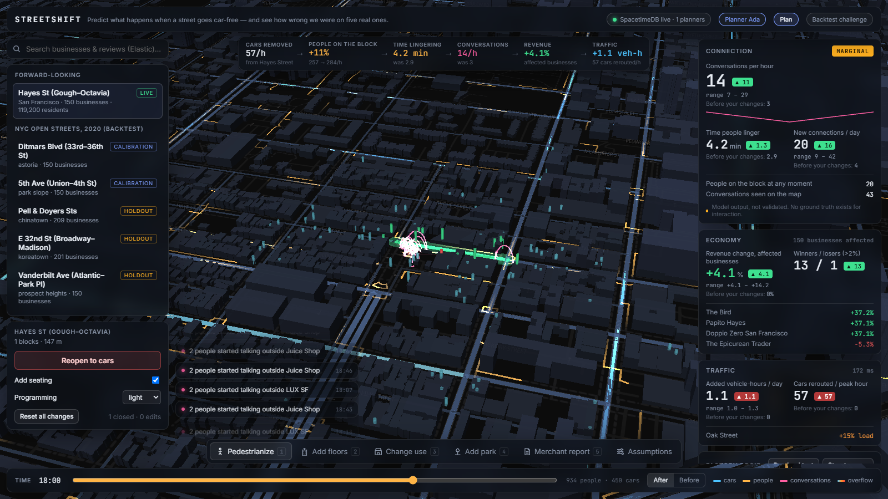
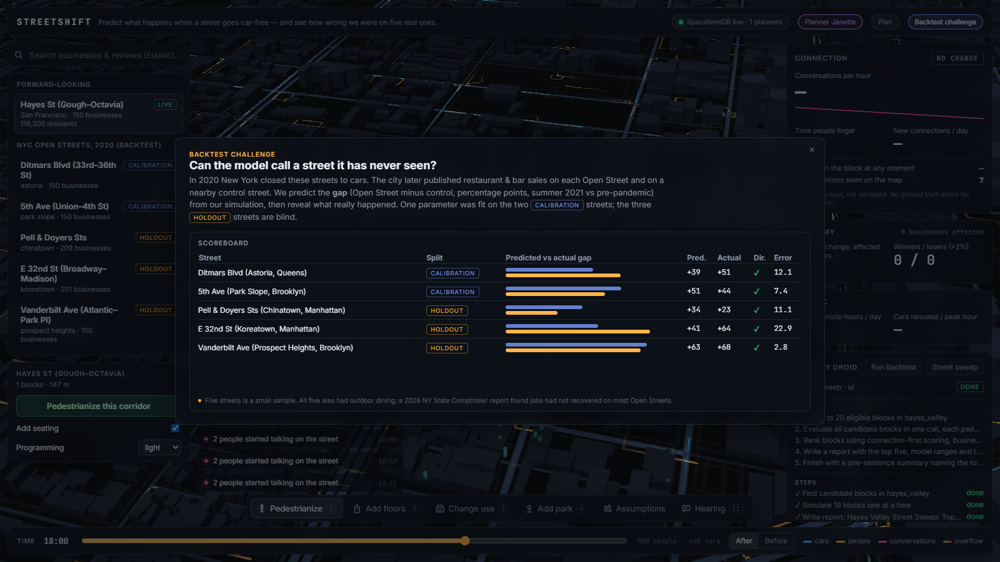
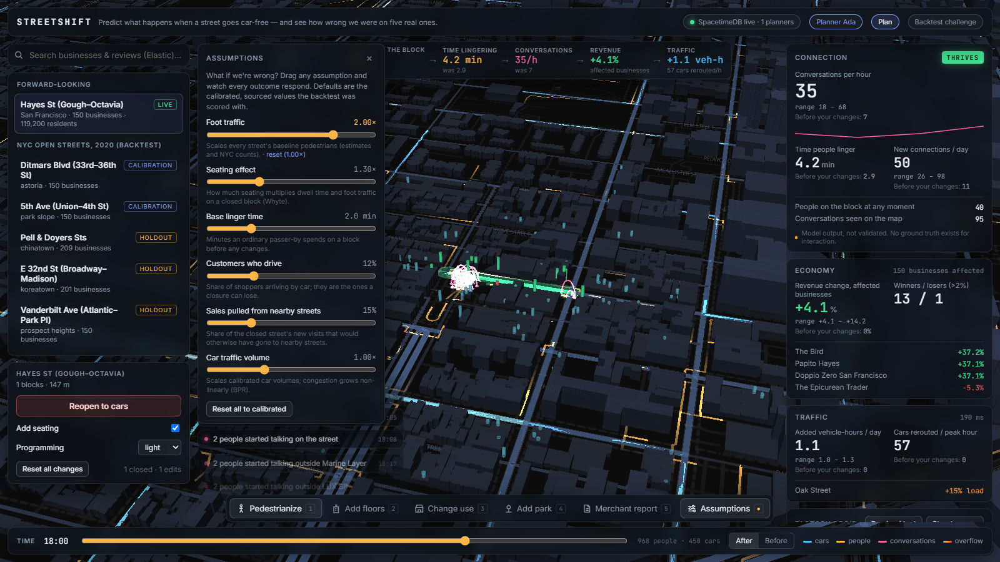
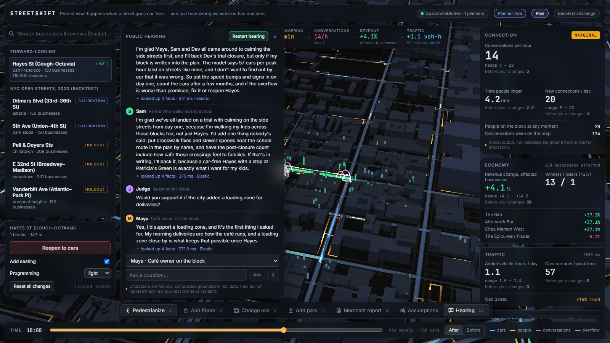

# StreetShift


**Predict what happens when a street goes car-free, and see how wrong we were on five real ones.**

Cities fight bitterly over pedestrianizing streets: merchants fear losing customers, residents fear overflow traffic, advocates promise vibrancy, and decisions get made on gut feeling. StreetShift simulates a closure on a real street and predicts three things, each with a range:

- **Connection** (the headline): conversations per hour, how long people linger, new connections formed, and whether the space **thrives, stays marginal, or dies off**.
- **Economy:** revenue change for every nearby business, with winners and losers.
- **Traffic:** added vehicle-hours and which streets absorb the overflow.

Then it **backtests itself**: on the five 2020 NYC Open Streets studied by NYC DOT, the model called the direction **5/5**, with a **12.3-point mean error on three blind holdout streets** (all three inside the predicted range). See [`validation/backtest_report.md`](validation/backtest_report.md).

| | |
|---|---|
|  |  |
|  |  |

## What you can do

- **Pedestrianize** any block on a real 3D map (Hayes St in San Francisco, plus five NYC corridors), with seating and programming options.
- **Add floors** to a building (more residents), **change a business's use**, **add a park**.
- **Drag the assumptions** (foot traffic, seating effect, linger time, share of drivers, sales diverted from nearby streets, car volume) and watch every outcome respond. The cause-and-effect strip shows the chain: cars removed → people on the block → time lingering → conversations → revenue → traffic.
- **Click a person** to see who they are (sized to the real Census population), how long they lingered and who they talked to. Pink arcs are conversations; the feed names the real business they happened outside.
- **Merchant Report** for any business (Claude-written, from the model's numbers).
- **Backtest Challenge:** predict a 2020 Open Street, then reveal the city's published sales data.
- **Public hearing:** four Claude stakeholders argue about your scenario, grounded in what they look up; ask any of them a question.
- **Factory Droid** re-runs the backtest or sweeps a neighbourhood for the best five blocks to pedestrianize, with every step shown live.
- **Ask from ASI:One:** "What happens if NYC pedestrianizes Ditmars Blvd?" reaches the StreetShift Analyst agent.
- **Multiplayer:** planners on the same corridor share edits, results, assumptions and cursors in real time.

## Architecture

```
 data/ (Python, uv)            sim/ (TypeScript, Node)                      web/ (React, Vite)
 OSMnx road graphs ──────────▶ traffic: OD trips, BPR congestion,  ──HTTP──▶ MapLibre 3D + deck.gl
 Apify Google Maps businesses  rerouting  · economy: capture, car            TripsLayer, arcs, columns
 US Census ACS 2024            loss, diversion · interaction: Whyte          panels, assumptions,
 NYC DOT counts (Socrata)      linger/encounters · trips for TripsLayer      hearing, backtest, Droid
 Elastic ingest + agent  ─┐    hearing (Claude + Moss/Elastic)                     ▲   ▲
 Moss facts index ────────┤          │ subscribe / publish                         │   │ Convex
                          │          ▼                                             │   │ (runs, reports,
                          │   SpacetimeDB (maincloud) ◀──── reducers / subscriptions┘   │  backtests)
                          │   scenario, closures, edits, results, metrics,              │
                          │   presence, hearing turns                         droid/ worker
                          └──▶ Elastic Serverless: businesses, reviews, briefs  (Factory Droid SDK)
 agents/ (Python): Fetch.ai uAgents on Agentverse (mailbox) → /sim; Claude reasoning
 validation/: ground truth (DOT PDF, page-cited), calibrate.ts, score.ts → backtest_report.md
```

Live state goes through **SpacetimeDB**: every edit is a reducer, the sim server subscribes, recomputes (≈0.1–1 s) and publishes results back, and every browser updates by subscription. Animated trips are precomputed per scenario and served as JSON (never per-frame writes).

## Where each sponsor is used

| Sponsor | What it does in StreetShift |
|---|---|
| **SpacetimeDB** | The real-time core. Module in `spacetime/spacetimedb/src/index.ts` (TypeScript, maincloud `streetshift-qf01o`): `scenario`, `closed_segment`, `scenario_edit` (floors, land use, parks, assumption knobs), `scenario_result`, `segment_metric`, `business_metric`, `presence` (multiplayer cursors), `hearing_turn`. All edits are reducers; `sim/src/live.ts` subscribes and publishes results. |
| **Convex** | Durable record (`convex/convex/`): `droidRuns` + `droidSteps` (live Droid log), `backtestResults`, `groundTruth`, `scenarios`, `reports` in **file storage**, and a **daily cron** that queues the street sweep. |
| **Factory Droid SDK** | `droid/src/worker.ts`. The UI's **Run backtest** / **Street sweep** buttons (and the Convex cron) queue a run; the worker claims it and runs a Droid session that records its plan, calls tools, and writes a report. **Scoped access:** autonomy Off; every native tool (shell, edit, web…) disabled; the permission handler approves only StreetShift's in-process MCP tools (`list_backtest_corridors`, `predict_corridor`, `score_backtest`, `list_candidate_blocks`, `evaluate_blocks`, `write_report`), which reach only the `/sim` API, the `/validation` scorer and `/reports`. Each tool call streams to Convex as a step. |
| **Elastic** (Serverless) | `businesses` (1,010) and `reviews` (36,416) indexes with `semantic_text`; **hybrid search** (BM25 + semantic, RRF, then Jina rerank) powers the search bar and the hearing's lookups; `carDependence` per business comes from a vocabulary + semantic query over reviews about parking and driving. **Agent Builder** agent `streetshift-analyst` with an index-search tool, ES\|QL tools `review_volume_by_month` and `car_dependence_by_corridor`, and the **Workflow** `corridor-brief` (manual + daily; searches a corridor's reviews, has a writer agent draft a stakeholder brief, saves it to `briefs`). See `data/elastic_*.py`, `data/workflows/corridor-brief.yaml`, `data/elastic_verification.md`. |
| **Apify** | Google Maps scraper for every treated and control corridor: businesses, categories, ratings, popular times, dated reviews (`data/scrape_apify.py`, cached in `data/raw/`). |
| **Anthropic (Claude)** | Hearing stakeholders and judge Q&A, Merchant Reports, the Analyst's routing and explanations. Model names come from `.env` (`ANTHROPIC_MODEL`, `ANTHROPIC_MODEL_FAST`); server-side refusal fallback is on; every response is cached to disk. |
| **Fetch.ai** | The **StreetShift Analyst** uAgent (Agent Chat Protocol 0.3.0, Agentverse mailbox): ask in ASI:One about any modelled street; it runs the scenario on `/sim` and answers with outcomes, ranges, full-time vs weekends-only comparisons, the backtest track record and a link. |
| **Moss** | Persistent cloud index `streetshift-facts` (3,787 business facts, review snippets and corridor facts, built by `data/moss_ingest.py`) plus a per-hearing **session index** that remembers what was said; hybrid search (alpha 0.6). The hearing tries Moss first and falls back to Elastic (see Limits). |

## Agents

| Agent | Address | Framework |
|---|---|---|
| StreetShift Analyst | `agent1qd4qtakflx6z29sy6m5m6vsv486hke5xnw3k2dvmghqed2tf2pnkgq67f58` | Fetch.ai uAgents 0.25.5, mailbox, Agent Chat Protocol; Claude reasoning |
| streetshift-analyst (Elastic) | Agent Builder in Kibana | Elastic Agent Builder (5 tools incl. Workflow) |
| Maya, café owner (stakeholder) | `agent1q2kp484c542e3r5s9u4gxrvf8k0unltcc6rlu853sdmqclhn0k8cgauwl9n` | uAgents, Agent Chat Protocol; answers via the `/sim` hearing (Claude + retrieval) |
| Dev, commuter (stakeholder) | `agent1qwcmvq3utu7qxf86ft9sl2pzukda9c5u9gr20gk2uuatp4anz9cmg26v8er` | same |
| Rosa, overflow-street resident (stakeholder) | `agent1qf0w5u5eqn3gjdghy0d440w8ygxs679hy3q752f7lah947up3gg7qaluefx` | same |
| Sam, parent (stakeholder) | `agent1q2xth6jd6sawnylvryj3772zdec9wsw54z5pcljsvpz8q5whxc4lx79hhn0` | same |

**Multi-agent:** ask the Analyst in ASI:One "What would people on Hayes Street think if it went car-free?" and it consults the four stakeholder agents over the Agent Chat Protocol, waits for their replies, and answers with the simulation plus each one's view and where they agree. Their turns also appear live in the app's hearing panel. Stakeholders are fictional composites grounded in real data.

## Validation protocol

- **Ground truth:** NYC DOT *Streets for Recovery* (2022) data appendix: restaurant & bar taxable sales on each Open Street and its control corridor, summer 2021 vs the pre-pandemic baseline. Extracted programmatically with page citations (`validation/extract_ground_truth.py`); sanity-checked against press figures (Astoria +44% vs −7%, Chinatown −8% vs −31%, averages +19.6% vs −28.8%).
- **Target:** the gap between treated and control (difference-in-differences; COVID hit both).
- **Split:** calibration = Ditmars Blvd, 5th Ave Park Slope; holdout = Pell & Doyers, E 32nd St, Vanderbilt Ave. One parameter (base pedestrian uplift) is fit on calibration only. `ground_truth.json` is read only by `validation/score.ts`; the calibrator can only request calibration rows.
- **Result (v1, the only truly blind run):** direction 5/5; MAE 9.8 pts calibration, **12.3 pts holdout**; 3/3 holdout actuals inside the predicted range; Spearman 0.50.
- **After a data fix** (businesses matched to their street by address, re-fit on calibration only, no longer strictly blind): direction 5/5; holdout MAE 12.6 pts; 2/3 inside range; Spearman 0.30. Both runs are in the report.

## Honest limits

- Five corridors is a small sample. All five had outdoor dining, so the model's effect is closure + seating together.
- Interaction outcomes (conversations, lingering, connections) are **model output, not validated**: there is no ground truth for them.
- Pedestrian volumes are estimated where no NYC count station is within 500 m; traffic is calibrated to nearby NYC counts and capped so no street starts above capacity.
- Business mix is today's Google Maps listings, not 2020's. Only the newest 60 reviews per business were scraped.
- A 2026 NY State Comptroller report found retail and restaurant jobs had not recovered on most Open Streets; the evidence on lasting effects is mixed.
- Hearing characters are fictional composites; they do not represent any real owner or resident. StreetShift tracks no real individuals.
- Moss: the index builds and is Ready in the cloud, but `loadIndex` timed out on the venue network, so the hearing currently retrieves through Elastic (shown in the "looked up" panel).

## Run it (Windows, no admin)

```
# one-time: uv, Node 20+, spacetime CLI, `npm install` in sim/ web/ droid/ convex/, `uv sync` in data/ agents/
cd sim    && node --import tsx src/server.ts      # :8787, connects to SpacetimeDB
cd web    && npx vite                              # :5173
cd droid  && npx tsx src/worker.ts                 # Factory Droid worker
cd agents && uv run python analyst/agent.py        # Fetch.ai Analyst (mailbox)
```
Data rebuild: `cd data && uv run python build_graphs.py && uv run python fetch_context.py && uv run python scrape_apify.py <area> && uv run python build_businesses.py && uv run python elastic_ingest.py && uv run python elastic_setup_agent.py`. Backtest: `npx --prefix sim tsx validation/calibrate.ts && npx --prefix sim tsx validation/score.ts`. Tests: `npm test` in `contracts/` and `sim/`.

All keys live in `.env` (see `.env.example`). Every sponsor sits behind a fallback (`USE_MOCK_*`).
